# 🛡️ team-harness — AI와 함께 쓰는 개발 기반

> **"여러 기술 영역의 개발·설정·검사 경험을 프로젝트마다 재사용한다."**


한 개발자가 프론트엔드·백엔드·DB·인프라를 맡아도 매번 기술 기준·설정·검사 방법을 처음부터 찾고
구성하지 않도록 돕는다. 실제 프로젝트에서 검증된 구성을 재사용하고, 유용한 부분부터 동료에게 공유한다.
현재 스택별 기준·템플릿·검사 연결 안내와 개발 조정 절차를 제공하며, 새 앱 전체를 자동 생성하지는 않는다.
기존 repo는 [선택형 온보딩](docs/guides/existing-repository.md)에서 필요한 자산만 고른다.

[공통 프로젝트 계약](plugins/harness-guard/skills/ao-coordinate/project-contract.md)에 따라 일반 설계·TDD·디버깅은 선택한 방법론(설치된 Superpowers 등)에 맡기고, Harness는 프로젝트 기준·검사·인계·delivery 조건을 연결한다. 스킬 이름을 외우지 않고 목표를 자연어로 요청한다.

로컬 프로젝트와 GitHub 제품 업무는 [혼자 개발](docs/guides/solo-development.md#개발자가-하는-일)·[작은 팀](docs/guides/team-development.md) 가이드에서 요청 예시와 단계별 완료 기준을 따라 시작한다.
준비된 Spring Boot·Vue·Node·React/Vite·Next.js·Nuxt 앱에는 [스택별 로컬 검사](docs/local-development.md)로
공통 검사 진입점을 미리 보고 추가할 수 있다. 스택은 단독으로 명시하며 앱·검사 도구는 제품에서 준비한다.
1.1.0은 [trusted stacked CI 선행 전달](docs/specs/stack-ci-bootstrap.md) 후보다. 전체 stack·dashboard 기능은 별도 1.2.0 범위이며, 실제 발행·설치 상태와 구분한다.
1.0.0 설치는 [발행 태그와 전달 기록](docs/specs/team-harness-redesign/delivery.md)을 확인한 뒤 진행한다.
기존 로컬 조합·기본 선택의 이전 방법은 위 안내를 따른다. GitHub에 연결할 때는
다음 세 계층으로 기존 품질·리뷰·배포 정책을 적용한다:

1. **Claude Code·Codex 플러그인 경로** — 가드·스킬·절차를 버전 있는 플러그인으로 배포
2. **repo 커밋 설정** — 규약의 단일 출처(`AGENTS.md`)를 도구 무관하게 공유
3. **git / CI 강제** — branch protection과 CI 게이트로 "지킬 수밖에 없는" 구조를 서버에 설치

핵심 통찰은 단순하다. **AI에게 "부탁"하는 규칙은 강제가 아니다.** 프롬프트와 훅은 우회될 수 있고,
도구마다 동작이 다르다. 그래서 강제력의 원천을 GitHub(서버)까지 내려보내고, 위 계층은
그 위에서 *편의와 자동화*를 제공하도록 역할을 나눈다.

## 제품 개발 조정

Agent Orchestration에서 필요한 인계·검증·재개 원칙만 선택형 `ao-coordinate`로 통합했다. 팀의 기술·품질 기준과 요청 → 구현 → 인계 → 검증 → 인수를 같은 Team Harness 안에서 연결한다. 제품 코드·요구·진행은 제품 저장소에 두며, 역할 실행은 native 도구를 쓴다. [개발자 사용 흐름](docs/guides/solo-development.md)에서 시작한다.

## 목차

- [제품 개발 조정](#제품-개발-조정)
- [✨ 주요 기능](#-주요-기능)
- [🧭 제품 방향](#-제품-방향)
- [🧱 기술 스택](#-기술-스택)
- [🏗️ 아키텍처](#️-아키텍처)
- [harness-guard 플러그인](#harness-guard-플러그인)
- [🚀 빠른 시작](#-빠른-시작)
- [🌐 English Quick Start](docs/quick-start.md)
- [🧩 Supported environments](docs/support.md)
- [🧪 테스트](#-테스트)
- [📁 repo 구조](#-repo-구조)
- [📚 팀 표준 문서](#-팀-표준-문서-docs)
- [📄 라이선스](#-라이선스)

---

## 🧭 제품 방향

개인 개발에서 반복 설정·조사·검사 구성을 줄이는 것이 우선이다. 실행 플랫폼의 공식 기능을 사용하고,
검증된 구성의 재사용과 **GitHub 정책·검증 증거·감사·PR/릴리스 delivery 강제**를 필요한 프로젝트에 연결한다.

신규 기능은 `소유 / 연결 / 위임`으로 판정한다. 서버 강제와 증거 계약은 직접 소유하고, skill·hook·subagent 등
플랫폼이 안정적으로 제공하는 실행 기능은 복제하지 않는다. 상세 원칙과 로드맵의 정본은
[`docs/product-direction.md`](docs/product-direction.md)다.

---

## ✨ 주요 기능

| 기능 | 설명 |
|---|---|
| 🛡️ 가드 훅 | main/develop 직접 커밋·force push·맨손 `gh pr` 차단 — 차단 시 audit 로그 기록 |
| 🧭 작업 계약 | 현재 요구·범위·완료 기준을 기존 제품 기록에 연결하고, 실패·미확인을 구분 |
| 🧠 맥락 기반 skill 선택 | 17개 description의 사용·제외 경계로 Claude Code·Codex implicit invocation 지원 |
| ✍️ 커밋 메시지 계약 | Conventional Commits 호환 한국어 형식을 로컬 `commit-msg`와 CI에서 강제하고 merge 예외는 Git metadata로 확인 |
| 🧭 체계적 디버깅 | `/systematic-debugging` — 선택한 진단 방법에 프로젝트 재현 증거·무수정 경계·수정 인계를 연결 |
| ✅ 완료 증거 게이트 | `/verification-before-completion` — 현재 worktree·HEAD에 유효한 증거 없이는 완료 판정 차단 |
| 🔄 git-flow 커맨드 | `/plan`·`/feature-add`·`/feature-merge`·`/release-check`·`/release`·`/hotfix` 전 구간 |
| 🔍 PR 게이트 스킬 | `pr-review-gate` — AI 리뷰·사람 승인·CI·commit-status 단일 절차 |
| 🔒 솔로 머지 | `/solo-merge` — 자기 PR 승인 불가 제약을 review 보호 일시 해제·복구로 처리 |
| 📦 드리프트 점검 | `/repo-sync` — 프로젝트 ↔ team-harness 표준 드리프트 감지 및 백필 PR 제안 |
| 🩺 런타임 진단 | `harness-doctor.sh` — Codex 설정·플러그인·repo·branch protection 종합 점검 + 선택적 fresh-session probe |
| 🏅 릴리즈 검증 | `/release-check` — repo가 선언한 품질·보안·DB·추가 검사와 현재 후보의 GO/NO-GO 판정 |

## 🧱 기술 스택

| 영역 | 스택 |
|---|---|
| 플러그인 배포 | Claude Code marketplace + Codex native plugin loader |
| 가드·훅 | Bash (PreToolUse: 실행 전 보호) |
| 연결·검증 | Node.js (스택 카탈로그·선택 자산·후보 증거 검사) |
| CI 게이트 | GitHub Actions (`templates/ci/`) |
| 에이전트 | Claude 역할별 agent + Codex native agent 실행 위임 |
| 테스트 | Bash 통합·Node 회귀·실제 호스트 실행 검증 |

기존 앱의 React+Vite·Nuxt·Python 프레임워크·Rails UI와 [버전 확인·기록·CI 연결](docs/stack-versions.md)을 지원한다.
최신 기본 제안은 호환 안정 버전이며 미확인·충돌에서는 적용을 중단한다. 실제 앱 검증은 별도다.
프론트 업무·상태·구조의 판단은 [설계 안내](docs/frontend-engineering.md)를 기존 계획·QA에 연결한다.

## 🏗️ 아키텍처


Codex·Claude가 실행하고, Harness가 정책과 검증 증거를 연결하며, GitHub가 설정된 서버 보호를 집행한다.
[훅 차이·병합 조건·상세 HTML·재생성 방법](docs/harness-architecture.md)을 읽는다.

## harness-guard 플러그인

[구성 요소·패키지 경계·Git 흐름](docs/harness-plugin.md)에 가드와 각 절차를 연결했다.

## 🚀 빠른 시작

처음이라면 아래 순서로 시작한다. 설치 명령과 복사용 요청문은 연결된 정본에서 가져온다.

| 순서 | 할 일 | 다음 단계로 넘어가는 기준 |
|---|---|---|
| 1. 준비 | [지원 환경](docs/support.md)과 [설치 전 준비](docs/harness-setup.md#설치-전-준비) 확인 | 선택한 Codex 또는 Claude Code를 실행하고 로그인할 수 있음 |
| 2. 설치 | [Codex](docs/harness-setup.md#codex-최초-설치갱신) 또는 [Claude Code](docs/harness-setup.md#claude-code-최초-설치) 안내 실행. 팀원도 각자 설치 | 설치 목록의 `harness-guard` 버전·활성 상태 확인 |
| 3. 저장소 연결 | 기존 저장소는 [필요한 구성만 선택](docs/guides/existing-repository.md), 새 프로젝트는 [온보딩](docs/onboarding.md#먼저-사용할-범위-선택) | 기존 규약·hook·검사 명령 확인 후 채택할 범위를 정함 |
| 4. 첫 확인 | **제품 저장소 루트에서 새 대화**를 열고 [혼자 시작하는 확인 요청](docs/guides/solo-development.md#처음-연결할-때) 또는 [팀 확인 요청](docs/guides/team-development.md#처음-함께-사용할-때)을 복사 | 수정 없이 현재 상태·완료 기준·허용 범위 확인 |
| 5. 실제 업무 | [혼자 개발](docs/guides/solo-development.md#혼자-개발할-때) 또는 [작은 팀](docs/guides/team-development.md#공유-업무와-담당자별-시작)의 업무 요청 사용 | 혼자는 작업 범위, 팀은 담당자·리뷰어·통합 책임을 정한 뒤 착수 |
| 6. 완료·인계 | 같은 사용 가이드의 단계별 완료 기준으로 결과 확인 | 현재 후보의 필수 검사·리뷰 증거와 잔여 항목을 대조하고, PR·발행 여부는 별도 보고 |

플러그인 설치만으로 저장소 파일·Git hook·원격 보호가 적용되지는 않는다. 기존 설정은 먼저 보존한다.
로컬 업무에는 GitHub가 필수가 아니다. GitHub를 쓰면 프로젝트가 선택한 브랜치 흐름과 기존 리뷰·CI를 따른다.
설치 확인과 실제 hook 실행 확인은 별개다. 막히면 [선택한 구성만 점검](docs/harness-setup.md#현재-상태-점검)한다.
[English Quick Start](docs/quick-start.md)도 제공한다.

## 🧪 테스트

```bash
bash tests/route-intent-test.sh   # 기본 연결에서 제외된 기존 라우터의 호환 회귀
bash tests/codex-fresh-session-smoke-test.sh
bash tests/harness-doctor-test.sh
bash tests/profile-lifecycle-test.sh
```

## 📁 repo 구조

```
team-harness/
├── .claude-plugin/marketplace.json    공개 플러그인 카탈로그
├── .githooks/pre-commit               계층 0.5 가드 — 이 repo 자체에도 적용 (dogfooding)
├── plugins/harness-guard/             플러그인 본체 (아래 상세)
├── experiments/split-packaging/      분리 패키지·profile 평가 (공개 설치 보류)
├── scripts/new-repo.sh                신규 repo 로컬 자산 연결 (원격 보호는 명시 선택)
├── scripts/harness-doctor.sh          Codex·repo·GitHub 상태 종합 점검 (`--probe`로 실세션 검증)
├── scripts/codex-fresh-session-smoke.sh  실제 ephemeral Codex hook 발화 검증
├── templates/                         신규 프로젝트에 복사하는 파일들
│   ├── AGENTS.md · CLAUDE.md          규약 단일 출처 + Claude 전용 지침
│   ├── settings.json                  .claude/settings.json (마켓플레이스·플러그인 선언)
│   ├── stacks.json                   개별6개 선택·조합·rules·required checks 정본
│   ├── ci/migration-safety.yml        마이그레이션 정적 게이트 (out-of-order·forward-only)
│   ├── ci/integration-e2e.yml         실 IdP·실 백엔드 통합 e2e (env-gated)
│   ├── ci/test-guard.yml · commitlint.yml · repo-sync.yml  거버넌스 게이트 (스택 무관)
│   ├── stacks/<스택>/                CI·rule·로컬 검사·보조 설정 정본
│   ├── ci/common/                    공통 CI 원문
│   ├── ci/stacks/ci-gate-*.yml        스택별 완성 생성물 (new-repo.sh가 복사)
│   ├── githooks/pre-commit            계층 0.5 git 훅
│   └── PULL_REQUEST_TEMPLATE.md · gitignore.snippet
└── docs/                              목적별 안내·guides/·specs/·pilots/ (분류는 docs/README.md)
```

수정할 정본·필수 배치 사본·생성 명령은 [저장소 유지보수 안내](docs/repository-structure.md)를 따른다.
기본 설정은 소비 프로젝트용이며 이 저장소의 `.claude/settings.json`과 적용 대상이 다르다.

## 📚 팀 표준 문서 (`docs/`)

[목적별 문서 찾기](docs/README.md)에서 시작한다. [표준 적용 기준](docs/standards-scope.md)에 따라 필요한 기준을 채택한다.
[스택별 문제 해결](docs/standards-scope.md#문제-해결-안내를-읽는-방법)은 공식 자료와 실행 결과를 구분한다.

| 문서 | 내용 |
|---|---|
| [product-direction.md](docs/product-direction.md) | 제품 정체성 · 소유/위임 경계 · 신규 기능 판단 게이트 · 우선순위 로드맵 |
| [public-safety-audit.md](docs/public-safety-audit.md) | Git 히스토리 시크릿 · 공개 식별정보 · 라이선스/provenance 공개 안전성 감사 |
| [platform-overlap-audit.md](docs/platform-overlap-audit.md) | skill · hook · agent · Codex 호환 계층의 소유/연결/위임 전수 분류 |
| [product-boundaries.md](docs/product-boundaries.md) | 프로젝트 연결·작업 계약·검증·GitHub 전달과 실제 설치 범위 |
| [developer-workflow.md](docs/developer-workflow.md) | 개발자의 일상 작업 가이드 — 기능·수정·머지·hotfix·release 흐름과 막혔을 때의 다음 행동 |
| [onboarding.md](docs/onboarding.md) | 신규 프로젝트 셋업 · 팀원 온보딩 · managed settings 로컬 시뮬레이션 |
| [stack-guide.md](docs/stack-guide.md) | 기술 스택·프레임워크·화면 방식 선택과 조건부 실무 기준 |
| [architecture-infra.md](docs/architecture-infra.md) | 레포 전략 · 모듈러 모놀리스→미니서비스 · GitOps · 인프라 |
| [clean-architecture.md](docs/clean-architecture.md) | 1차 경계=도메인 모듈, 2차 경계=내부 계층 |
| [api-standards.md](docs/api-standards.md) | 공통 Envelope · 에러코드 체계 · 페이지네이션 |
| [db-standards.md](docs/db-standards.md) | BIGINT PK+채번 · 공통 감사 컬럼 · forward-only 마이그레이션 |
| [auth-standards.md](docs/auth-standards.md) | Keycloak OIDC · RBAC 권한코드 + 데이터 스코프 |
| [code-review.md](docs/code-review.md) | Git Flow 순서 · 현재 후보 리뷰·CI·보호·병합 계약 |
| [ai-collaboration.md](docs/ai-collaboration.md) | AI 협업 책임 원칙 · 도구 공통 금지사항 |
| [operations.md](docs/operations.md) | 장애 대응 · 로그 레벨 기준 · traceId 전파 (서비스 오픈 시 활성화) |
| [troubleshooting.md](docs/troubleshooting.md) | 가드 차단 사유별 해법 · 훅 미발동 · 의존성 fail-closed · 감사/복구 |
| [model-tiering.md](docs/model-tiering.md) | Claude 역할 매핑·Codex 승인된 native 역할·실제 모델/effort 사용 점검 |
| [decisions.md](docs/decisions.md) | 확정 결정의 단일 출처 — 결정·정본 문서·영향 문서 |
| [harness-maintenance.md](docs/harness-maintenance.md) | 하네스 자체 변경 절차 · 플러그인 버전 정책 · 전파 방식 |
| [readme-standards.md](docs/readme-standards.md) | 프로젝트 repo README 표준 양식 |

## 운영 원칙과 이력

현재 원칙·우선순위는 [제품 방향](docs/product-direction.md#우선순위-로드맵), 변경·전파는
[유지보수 규약](docs/harness-maintenance.md)을 따른다. [초기 구축 이력](docs/harness-operating-history.md)은 당시 기록이다.

## 📄 라이선스

MIT — 2026-07 public 전환(decisions #73). 루트 [`LICENSE`](LICENSE) 참조.
