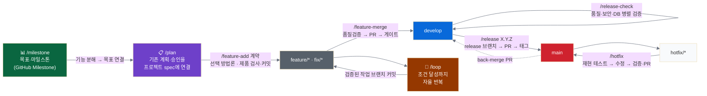

# Harness 플러그인과 Git 흐름

[README로 돌아가기](../README.md). 이 문서는 해당 주제의 상세 정본이다.

## harness-guard 플러그인

공식 플러그인이 제공하지 않는 **자체 정책만** 담는다.

현재 공개 설치 단위는 `harness-guard` 하나다. 설치·확인은 [설치 안내](harness-setup.md)를 따른다.
분할 패키지·profile·staged artifact는 [실험 정본](../experiments/split-packaging/README.md)에서만 다룬다.
공개 marketplace 설치 대상으로 승격되지 않았으며 다음 배포로 확정된 구성이 아니다.

| 구성 요소 | 내용 |
|---|---|
| **가드 훅** (PreToolUse) | `guard.sh` — main/develop 직접 커밋·force push, `git reset --hard`, **검증기·마이그레이션 삭제**, 핵심 디렉터리 `rm -rf`, npm 글로벌 설치, **맨손 `gh pr create`·`gh pr merge`**(PR 생성·머지는 래퍼 스크립트=스킬 경유만 — 반사적 우회 차단) 차단 (`cd` 체인·서브셸·`git -C` 우회 포함, 보조 장치 — 최종 강제는 계층 0). **차단 시 `~/.claude/hooks/guard-block.log`에 session_id·cwd·명령(크레덴셜·토큰 마스킹) 기록**(멀티세션 위반 시도 감사). + LLM 프롬프트 훅 — 시크릿 외부 유출 패턴 전용 탐지 |
| **PR 래퍼 스크립트** | `pr-create.sh`(명시 base·제품 branchFlow 검증 후 push·생성) · `pr-merge.sh`(CI·스레드·mergeable 게이트 후 머지) — guard가 맨손 gh를 막으므로 **PR 생성·머지의 유일 경로**. 스킬이 이 스크립트를 호출(내부 gh는 자식 프로세스라 훅에 안 걸림) |
| **native skill 선택·명시 호출** | runtime이 description의 사용·제외 경계와 현재 요청으로 선택한다. 잘못 선택하면 스킬을 명시한다. 기본 UserPromptSubmit 라우팅은 제거했으며, 스킬 선택은 실행 권한을 확대하지 않는다. |
| **마일스톤 커맨드** | `/milestone` — 제품·마일스톤 정의→기능 분해→GitHub 마일스톤 생성→진행률 대시보드. `/plan` 위에 놓이는 목표 레이어. Claude Code 내장 `/goal`(세션 stopping condition)과 보완 관계 |
| **계획 계약** | `/plan` — 선택된 방법론의 계획·승인을 프로젝트 spec·수용 기준에 연결. 기존 계획을 재사용하고 Git은 변경하지 않음 |
| **개발 계약** | `/feature-add` · `/feature-modify` — 선택된 구현 방법론에 테스트 무결성·AGENTS.md 검사·제품 커밋 규약을 연결 |
| **개발 조정** | `/ao-coordinate` — 여러 단계의 현재 후보·담당 범위·인계를 연결하고 중단된 작업을 재개 |
| **진단 계약** | `/systematic-debugging` — 선택된 진단 방법에 프로젝트 재현 증거·무수정 경계를 연결. 원인 확인과 수정 승인 후 구현 계약으로 인계 |
| **완료 검증 스킬** | `/verification-before-completion` — 현재 worktree·HEAD에 유효한 증거로 검증하며 같은 후보·환경·범위의 결과를 재사용. 변경·gate 신선도 조건에는 재검사, 실패·미확인은 fail-closed |
| **자율 루프 커맨드** | `/loop` — 동기 조건-루프. CI·lint·테스트 등 "통과할 때까지 즉시 반복" 작업을 timeout·max·내용 기반 stuck·안전 checkpoint 안에서 자동화. 맥락 자동 선택은 명시적 요청 없이 commit하지 않으며 시간 예약 polling과 별개 |
| **품질 커맨드** | `/qa` — 프론트엔드 QA: 디자인 토큰 준수 + WCAG 2.2 접근성 검증 (`/feature-add`의 TDD 로직과 직교한 비주얼·a11y 축) |
| **릴리즈 검증** | `/release-check` — 릴리즈 전 품질(Agent A)·보안(Agent B)·DB 마이그레이션(Agent C) 병렬 검증 + manifest가 있을 때 외부 파일럿 live provenance |
| **드리프트 점검** | `/repo-sync` — 프로젝트 ↔ team-harness 표준 드리프트 점검(`check-repo-sync`). commit-msg·validator·CI·rules 등 필수 자산 누락 리포트 |
| **PR 생성** | `/pr-create` — 명시 `--base` 또는 제품 `.harness-policy.json`의 `branchFlow`로 PR 생성. `main`은 main, `git-flow`는 develop 대상이며 develop 존재로 추정하지 않는다. 명시 base·선언이 둘 다 없거나 충돌하면 push 전 중단. `feature-merge`가 PR 생성 단계를 위임 |
| **머지·릴리즈 커맨드** | `/feature-merge` · `/hotfix` · `/release` · `/solo-merge` — git-flow 전 구간을 게이트 경유로 자동화 |
| **리뷰 게이트** | `/pr-review-gate` — PR 생성→머지의 표준 절차. AI 리뷰 스레드 reply+resolve, 사람 승인 확인, CI watch, 외부 배포 commit-status 검증 |
| **에이전트** `security-reviewer` | 릴리즈 전 보안 검토 기준 — Claude agent로 제공하고 Codex 실행·모델 선택은 native agent에 위임 |
| **에이전트** `verifier` | 검증·연구·설계 반증 기준 — Claude agent로 제공하고 Codex 실행·모델 선택은 native agent에 위임 |

### git-flow와 커맨드의 관계

아래는 Git Flow를 채택한 제품의 예시다. main 중심 제품에 develop·release를 강요하지 않는다.
이 team-harness 저장소의 필수 순서는 [Git Flow 순서 검사](code-review.md#git-flow-순서-검사--team-harness-자체-전달)를 따른다.

흐름: `/milestone`(목표·마일스톤 정의) → `/plan`(기존 계획·승인을 프로젝트 spec에 연결) → **`feature/*` 한 브랜치**에서 선택한 방법론과 `/feature-add` 프로젝트 계약 →
`/feature-merge`(한 PR). *한 기능 = 한 브랜치 = 한 PR.*
`/loop`: 작업 브랜치에서 CI·lint·테스트 등 반복 수정을 exit 0까지 동기 자율 실행. 자연어 맥락으로 자동
선택되면 명시적 commit 요청이 없는 한 검증된 변경을 작업트리에 둔다.
내장 `/goal`(세션 stopping condition)·`/loop`(ScheduleWakeup 비동기)는 별도 유지.

모든 경로는 PR을 경유하고, 머지 전에 `pr-review-gate`의 게이트
(AI 리뷰 처리 → CI → 외부 배포 상태, **팀 모드는 + 사람 승인**)를 통과해야 한다.
**솔로 표준**(승인요건 0)에선 사람 승인 단계는 생략된다. wrapper가 CI·스레드 resolve를 확인하고,
설정된 GitHub 보호의 required checks·enforce_admins가 서버에서 CI-green을 강제한다(pr-review-gate §4).
실제 보호 설정·허용된 예외·직접 API 권한도 확인해야 하며, 문구나 로컬 hook만으로 우회 불가를 보장하지 않는다.
팀의 기존 사람 승인·CODEOWNERS·검사·제한은 보존한다. 보호 변경은 별도 승인 범위에서
[회사 정책](company-policy.md)을 따른다. `set-branch-protection.sh`의 `--approvals N`은 main,
`--develop-approvals N`은 develop 대상이며 생략한 승인 수는 보존하고 하향은 거부한다.
리뷰어 부재를 solo 전환이나 승인 삭제 근거로 삼지 않는다.

---
