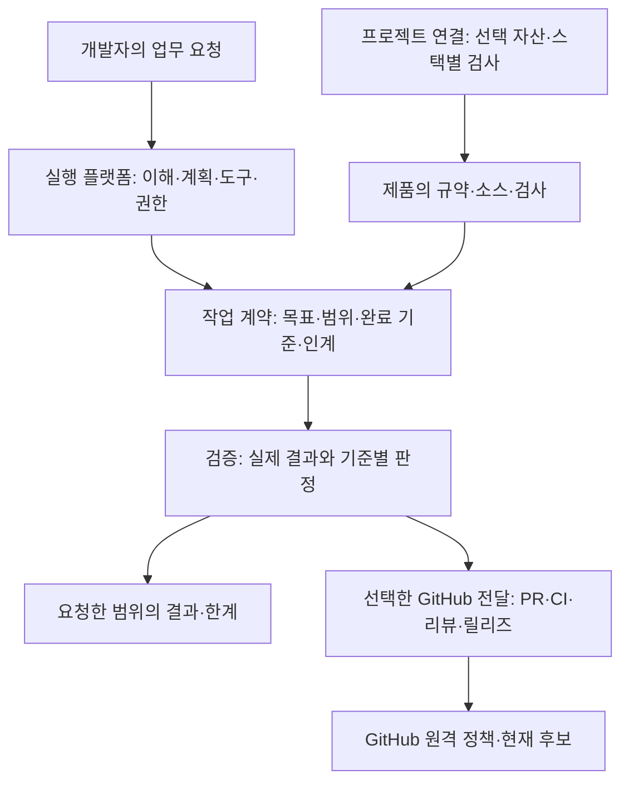

# Team Harness 전체 재설계

상태: **M1–M5 구현·고정 범위 검증 완료, M6 정식 전달 승인**. 2026-10-15 사용자가 재설계안대로 M1부터 순서대로 구현·검증을 승인했다.
기존 작업·보호·Git Flow와 R1–R7을 유지한다. 전역 설정·소비 제품·원격 발행 권한은 자동 확대하지 않는다.
실행·판정은 [구현 기록](team-harness-redesign/execution.md)에 연결한다. [M6 전달 계약](team-harness-redesign/delivery.md)에 따라 1.0.0의 PR·태그·설치를 순서대로 진행한다.

## 1. 해결할 문제

혼자 또는 작은 팀이 기존 제품에서 AI와 설계·진단·개발·리뷰·유지보수·인계를 수행할 때,
프로젝트마다 검사·규칙을 다시 연결하는 부담을 줄이고 **어디까지 완료했는지 믿을 수 있게 한다.**
사용자가 반복해서 “빠진 것은 없나”를 물어야 완료 조건이 바뀌는 구조를 고친다.
모든 업무의 정답·무결함·생산성 우위를 보장하는 제품은 만들지 않는다.

제품의 약속은 세 가지다.

1. 기존 프로젝트의 규약·변경·검사를 보존하면서 필요한 연결만 제공한다.
2. 맡긴 목표·허용 범위·완료 기준과 실제 결과를 같은 기준으로 대조한다.
3. GitHub를 사용하는 경우 현재 후보의 검사·리뷰·정책·복구를 통과한 전달을 지원한다.

## 2. 재설계의 근거와 진단

검토 기준은 develop `11b2b714f18e42cfad61b1288fe57664fcf967f0`과 미발행 후보
`f11280e50da61b92d203175404a524b6bc311697` 및 기존 미커밋 평가 보완이다.
파일·호출부·현재 독립 리뷰를 읽었다. 이번 설계에서 설치·배우 시험·원격 검증은 새로 하지 않았다.

| 원본에서 확인한 사실 | 설계에 주는 의미 |
|---|---|
| [현재 QA 계약](../../plugins/harness-guard/skills/verification-before-completion/SKILL.md)에 요구·관찰·실패 보존 규칙이 이미 있다 | 규칙을 더 적는 것만으로는 해결되지 않는다 |
| [최근 평가](../pilots/current-evaluation-2026-10-15.md)의 평가기가 캐시를 제외해 자동 쓰기를 놓쳤다 | 판정기의 관찰 범위와 주장 범위가 일치해야 한다 |
| 최종 독립 리뷰는 제한된 A/B/C PASS와 추가 배우 반복 불필요를 확인했다 | 기존 제외 항목을 새 필수 조건으로 바꾸면 안 된다 |
| 최신 결과 JSON에 전체·세션·리뷰 판정이 여러 위치에 기록된다 | 한 결과에서 보고를 파생하고 독립 PASS 사본을 줄여야 한다 |
| [제품 경계](../product-boundaries.md)는 core·adapter·workflow와 분리 실험을 중심으로 설명한다 | 내부 포장 구조보다 사용자 업무와 실제 지원 경계를 먼저 설명해야 한다 |
| README·일상 가이드·기존 repo 안내의 시작 조건과 브랜치 가정이 다르다 | 문서와 실제 호출의 기본값을 함께 정리해야 한다 |

이 근거는 모든 과거 릴리즈의 실패를 증명하지 않는다. 기존 버전의 시험·태그·설치 기록은 보존한다.
현재 세 흐름의 인수도 소급 취소하지 않는다. 새 설계의 채택 여부와 과거 판정은 별개다.

## 3. 선택한 접근

| 접근 | 이점 | 비용·판단 |
|---|---|---|
| 현재 구조에 지침·시험 추가 | 변경이 작음 | 독자 경로와 결과 중복이 남아 근본 해결안으로 채택하지 않음 |
| **제품 경계부터 재정의하고 검증된 구현을 옮김** | 책임·사용 경로·판정을 다시 설계하면서 보호 동작을 보존 | 추천. 기능별 교체와 이전 검증이 필요 |
| 기존 코드 폐기 후 일괄 재작성 | 낡은 구조를 즉시 없앰 | 가드·복구·호환성 회귀 위험과 재검증 비용이 커서 채택하지 않음 |

전체를 다시 설계하되 모든 줄을 다시 쓰는 것을 목표로 삼지 않는다.
설계가 요구하는 책임에 맞는 구현만 재사용하고, 현재 파일 배치·스킬 수·패키지 수는 고정 조건에서 뺀다.

## 4. 새 구조



네 책임은 [구조·사용 경로](team-harness-redesign/architecture.md)에서 입출력·소유·실패 경계를 정한다.
네 개의 별도 설치 패키지를 뜻하지 않는다. 공개 플러그인은 하나로 유지하며 native adapter는 얇게 둔다.

- **프로젝트 연결:** 이미 있는 검사를 찾고 부족한 연결만 preview/apply한다. 앱 생성은 맡지 않는다.
- **작업 계약:** 기존 스펙·이슈·PR 하나에서 요청과 수용 기준을 유지한다. 작업 서버나 새 역할 엔진은 없다.
- **검증:** 실제 실행의 사실과 의미 판단을 구분한다. Harness 자체 평가는 재현 가능한 저장소 시험으로 관리한다.
- **GitHub 전달:** 프로젝트가 선택한 브랜치 정책과 현재 서버 보호를 사용한다. 실패·조회 불가·후보 변경을 차단한다.

## 5. 유지·제거·변경

| 대상 | 설계 결정 |
|---|---|
| required CI·후보 SHA 결박·리뷰·보호 복구·secret/test/migration guard | 보존. 교체 시 동일 정상·거부·복구 결과를 먼저 입증 |
| 스택 카탈로그·기존 자산 보존·단독 로컬 checker | 보존·정리. 지원 실행기와 검사 범위를 한 정본에 표시 |
| 별도 runtime·권한·agent·모델 설정 | 플랫폼에 위임. Harness가 설치·복제하지 않음 |
| 복잡한 공개 split package/profile 전환 | 기본 제품 로드맵에서 제외. 실험과 역사만 보존 |
| 짧은 자연어를 Git 상태로 분류하는 route-intent | 기본 hook 연결 제거. 명시 스킬·native 선택으로 대체; legacy 소스·시험은 보존 |
| 반복 방법론·모든 작업에 주입하는 긴 규칙 | 공통 최소 계약과 해당 작업에 필요한 참조로 축소 |
| 스킬 17개 | 숫자를 유지하거나 줄이는 목표 없음. 실제 고유 기능이 없는 연결만 합치고 이전 이름은 전환 안내 |
| 여러 문서·JSON의 독립 완료 상태 | 업무의 현재 정본 하나와 근거에서 파생하는 보고로 변경 |
| 회사/개인별 중복 온보딩 | 모든 기존 프로젝트의 한 경로로 통합. 실제 정책이 있을 때만 정책 보존 절 적용 |
| 과거 실행·실패·소비 제품 기록 | 보존. 현재 지원 설명·현재 완료 집계와 분리 |

로컬 Spring Boot+Vue 조합 제거 결정은 유지한다. GitHub CI 조합 지원을 같은 이유로 삭제하지 않는다.
기술스택은 backend/frontend 고정 쌍이 아니라 **앱 경로 + 스택 + 실행기 + 검사 명령**으로 다룬다.

## 6. 완료 판정의 핵심 변경

[완료·검증 설계](team-harness-redesign/completion.md)를 구현보다 먼저 확정한다.

- 기준에는 ID·요구 출처·필수 여부·관찰 경계·기대 결과가 있다. 작은 작업은 기존 기록의 짧은 목록이면 된다.
- 사용자 승인 범위와 기술적 시험 범위를 구분한다. 작성된 계획 파일 자체는 승인 증거가 아니다.
- 새 발견이 기존 필수 기준을 반증하면 해당 결과를 정정한다. 새 목표면 별도 제안으로 남긴다.
- 원문 누락·다른 후보·관찰 제외 영역은 PASS가 아니다. 사람 판단을 해시나 문구 검사로 대체하지 않는다.
- 국소 PASS를 제품 전체·설치·회사 효용의 PASS로 자동 승격하지 않는다.

최근 제안했던 “실제 진입 경로 확인”은 새 지원 경계를 검증할 항목이다. 기존 A/B/C의 소급 실패가 아니다.
캐시 제외 누락은 기존 기준 위반을 놓친 평가기 결함이다. 원본 재현과 현재 수정 결과를 모두 보존한다.
이 두 항목을 같은 종류의 “남은 필수 작업”으로 보고했던 판단도 바로잡는다.

## 7. 설계 수용 기준과 제품 수용 기준

**이번 설계 완료:** 전체 책임·공개 진입·지원 경계·판정·이전·종료 조건을 구체화하고 독립 반증을 반영한다.
이는 새 제품 구현·품질·실제 호스트 동작의 PASS가 아니다. 설계 승인 이후 제품은 다음 기준을 적용한다.

| ID | 제품 수용 기준 | 증거 |
|---|---|---|
| R1 | 기존 제품에서 필요한 구성만 연결하고 기존 규약·사용자 변경·제품 필수 검사를 보존 | 정상·충돌·미지원·동시 변경·중간 실패·중단 후 수동 복구 시험 |
| R2 | 설계/진단/리뷰 요청은 해당 범위를 지키고 승인된 변경만 수행 | 실제 진입부터 결과까지의 선정 업무 시험 |
| R3 | 기준·후보·실행·관찰·독립 판정이 연결되고 누락/모순은 완료를 막음 | 결함·누락·stale·추가/삭제 파일 반례 |
| R4 | 새 문맥·다른 writer·최신 요구에서 소유 범위와 전체/부분 결과를 정확히 인계 | 실제 격리 세션·writer 관측·통합 결과 |
| R5 | GitHub 연결은 채택한 흐름·현재 후보·보호·필수 검사·리뷰·복구를 보존 | 기존 회귀와 새 정책 선택 반례·승인된 원격 검증 |
| R6 | 구조 문서 지원 표의 필수 실행 경로가 동일 계약을 제공하고 갱신/복구 시 다른 설정을 보존 | 소스→artifact→공식 loader→실행 관측; 호환 유지 행은 소스 회귀만 |
| R7 | 처음 읽는 사용자가 한 시작 경로에서 준비·업무·완료·전달 범위를 구분 | 새 문맥의 문서 기반 실제 경로 검증; 실제 사람 효용은 별도 주장 |

반례 상세와 필요한 공개 지원 범위는 하위 설계에 있다. 테스트 수·릴리즈 수를 완료 기준으로 사용하지 않는다.
효용은 반복 설정·누락·재작업과 시간·문맥 비용으로 관측한다. 효과가 확인되지 않은 편의 계층은 채택하지 않는다.
모든 Harness 기능의 인과적 생산성 우위를 출시 조건으로 요구하지도, 관측 없이 광고하지도 않는다.

## 8. 이전 순서와 종료

[이전·검증 순서](team-harness-redesign/migration.md)의 M0–M6을 따른다.
우선 판정 구조와 현재 평가기 반례를 고정하고, 프로젝트 연결 → 실제 지원 진입 → 전달 통합 순으로 진행한다.
기존 1.0.0 후보는 설계 비교·재사용 자료다. 이 설계 요청으로 자동 발행하거나 삭제하지 않는다.
실제 회사·참여자·소비 제품 수정과 Claude 실호스트 보류를 현재 필수 대기로 다시 넣지 않는다.
원격 전달 승인 후에는 이 저장소의 작업→develop 확인→release→main→태그→develop 역병합 순서를 지킨다.

현재 진행: M1–M5의 R1–R7을 정해진 범위에서 충족했다. 구현 후보 `71a1d63`의 실제 CLI·데스크톱과 독립 검토를 확인했다.
M1–M5 종료 당시 설치는 `v0.93.2`로 복구했다. 이후 승인된 M6의 실제 병합·발행·설치는 전달 계약의 원본에서 확인한다.
새 설계의 필수 범위와 공개 지원 경계를 확정한 뒤, 실패는 영향 부분만 고치고 관련 증거만 다시 모은다.
필수 기준과 전달 범위를 충족하면 종료한다. 가능한 모든 개선을 현재 목표에 추가하지 않는다.

## 9. 설계 검토와 문서 연결

2026-10-15 별도 인스턴스가 새 설계 4문서와 현재 구현·계약을 대조했다. 첫 검토는 P2 두 건으로 FAIL이었다.
필수 호스트 집합 미고정과 동시 수정·중간 종료 복구 계약 누락을 보완한 뒤, 영향 재검토에서 두 건 해소를 확인했다.
읽기 전용 요청으로 수행한 문서 검토이며 기술적 sandbox·실제 호스트 동작·구현 품질·릴리즈 승인은 검증하지 않았다.
실행 메타데이터 조회와 설계 검토를 제품 실행 시험으로 집계하지 않는다.

문서 검증은 `scripts/check-markdown-structure.mjs`의 소유 문서 길이·참조 검사와 `git diff --check`,
아래 선언을 대상으로 한 `check-document-sync.mjs --record`를 사용한다. 선언 누락·의미 적합성은 기계 검사의 보장 밖이다.
구현 단계에서는 README·사용 가이드·설치 안내·직접 소비 문서를 함께 갱신하고 실제 검증 결과와 대조한다.
기존 평가·제품 코드·버전의 미커밋 변경은 이 설계 작업과 구별하여 보존했다.

```harness-doc-sync
{
  "version": 1,
  "documents": [
    {"path": "docs/specs/team-harness-redesign.md", "reason": "원점 재설계의 범위·수용 기준·현재 단계"},
    {"path": "docs/specs/team-harness-redesign/architecture.md", "reason": "책임·사용 경로·지원 집합·복구 경계"},
    {"path": "docs/specs/team-harness-redesign/completion.md", "reason": "완료 판정·반례·증거 계약"},
    {"path": "docs/specs/team-harness-redesign/migration.md", "reason": "단계별 작업·시험·전달 경계"},
    {"path": "docs/product-direction.md", "reason": "승인된 재설계 구현·검증 완료 연결; 기존 역사 체크리스트 보존"},
    {"path": "docs/specs/team-harness-redesign/execution.md", "reason": "현재 후보와 단계별 실제 실행·한계 정본"},
    {"path": "docs/specs/team-harness-redesign/delivery.md", "reason": "승인된 M6 순서·현재 원격과 설치 증거 연결"},
    {"path": "docs/pilots/redesign-2026-10-15.json", "reason": "고정 후보·품질·CLI/데스크톱·독립 판정 원문 지문 연결"},
    {"path": "README.md", "reason": "단일 시작 경로와 native 선택"},
    {"path": "AGENTS.md", "reason": "현재 hook 및 작업 계약"},
    {"path": "docs/company-onboarding.md", "reason": "기존 repo 공통 시작"},
    {"path": "docs/developer-workflow.md", "reason": "명시 skill과 자연어 선택"},
    {"path": "docs/development-coordination.md", "reason": "인계와 native 연결"},
    {"path": "docs/product-boundaries.md", "reason": "네 책임과 현재 제품"},
    {"path": "docs/product-boundary-experiment.md", "reason": "기존 분리 실험의 역사 보존"},
    {"path": "docs/repo-assets.md", "reason": "동시 변경 보존·중단 복구"},
    {"path": "docs/company-policy.md", "reason": "채택한 branchFlow와 명시 base"},
    {"path": "docs/code-review.md", "reason": "PR base와 기존 보호"},
    {"path": "docs/harness-setup.md", "reason": "로컬 시작과 선택 원격"},
    {"path": "docs/harness-architecture.md", "reason": "현재 hook 연결"},
    {"path": "docs/harness-plugin.md", "reason": "현재 skill·hook"},
    {"path": "docs/platform-overlap-audit.md", "reason": "현재와 legacy 인벤토리"},
    {"path": "docs/repository-structure.md", "reason": "생성 정본·reader"},
    {"path": "docs/ai-collaboration.md", "reason": "native 선택 및 검증"},
    {"path": "docs/decisions.md", "reason": "기본 routing 제거와 재설계"},
    {"path": "docs/onboarding.md", "reason": "공통 시작 안내"},
    {"path": "docs/specs/codex-guard-compatibility.md", "reason": "지원·호환 상태"}
  ],
  "items": []
}
```
